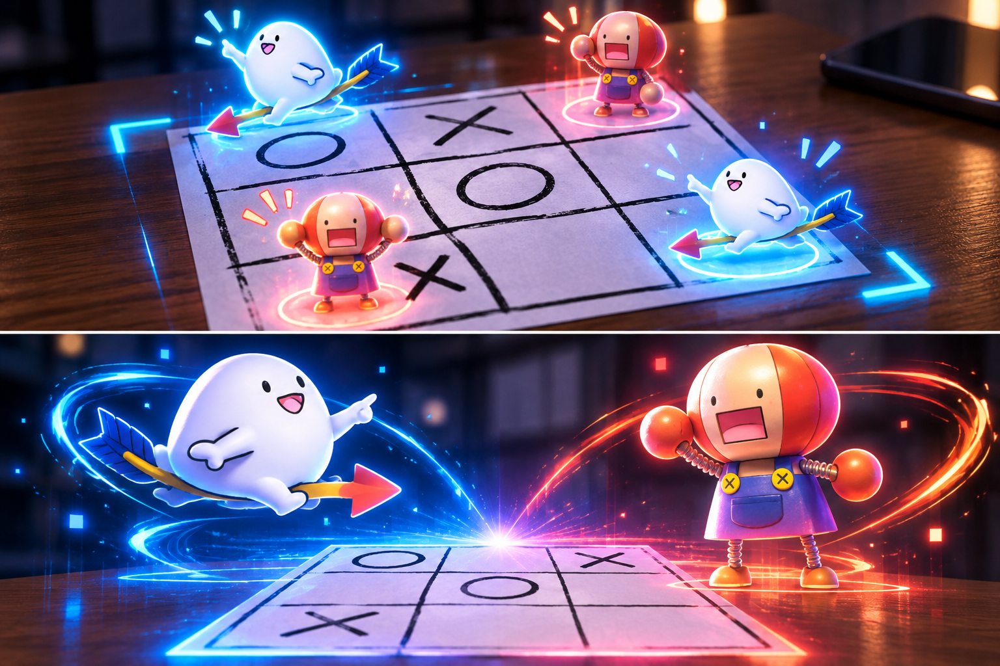

# 飛び出せ！DXまるばつげーむ！

※完成イメージです。現在の実装画面ではありません。

紙への手書き○×を入力にするAR三目並べ。開発方針は [PROJECT_SPEC.md](PROJECT_SPEC.md)、技術調査と実装計画は [Docs/TECHNICAL_PLAN.md](Docs/TECHNICAL_PLAN.md) を参照。

## 開発環境

- Unity **6000.3.24f1** / Built-in Render Pipeline
- Vuforia Engine **11.4.4**（既存の隣接チュートリアルにあった配布パッケージを同じバージョンで利用）
- Windows 11 / Unity Editor の Webcam Play Mode
- OpenCV は未導入。Phase 2 で統合方法とライセンスを確定する。

## Phase 1 を試す

1. Vuforia Engine **11.4.4** の公式配布パッケージ `com.ptc.vuforia.engine-11.4.4.tgz` を各自取得し、`Packages/` に配置する（公開リポジトリには同梱しない）。その後Unity Hubでこのフォルダーを追加し、6000.3.24f1で開く。
2. `Assets/Marubatsu/Scenes/Phase1_BoardTracking.unity` を開く。未生成の場合は `Marubatsu > Create Phase 1 Scene` を一度実行する。
3. `Window > Vuforia Configuration` で自分の App License Key を設定し、Play Mode を Webcam にしてカメラを選択する。設定は各PCで行う。キーをコードやGitに記録しない。
4. `Print/Board_A4.svg` をブラウザーで開き、A4・倍率100%で印刷する。用紙に合わせる拡大縮小は無効にし、下の100 mm線を定規で確認する。認識画像の外寸は **180 × 180 mm**。
5. Play を押し、紙の全体をカメラに映す。青い立方体9個は配置確認用であり、手書き認識結果ではない。
6. Console の `[BoardTracker]` と `[CameraFrameProbe] CPU copy OK` を確認する。認識を失ったら立方体が隠れ、再認識で戻ることを確認する。

このシーンは **Instant Image Target** による初期検証用。Target Manager登録・星評価・実カメラによる安定性検証は未実施。正式なデータベースターゲットへの切替手順と検証条件は [Docs/PHASE1_CHECKLIST.md](Docs/PHASE1_CHECKLIST.md) を参照。

通常のWindows Standalone（Win32 `.exe`）はVuforiaのサポート対象ではない。まずEditor内で検証し、配布が必要になった時点で対応プラットフォームを再検討する。

## 共同開発

- 担当A: Vuforia追跡・カメラフレーム・座標変換・画像認識。
- 担当B: Vuforia非依存のゲームロジック・表示Prefab・演出。
- シーンの編集担当を一人に決め、もう一人は別Prefab・コードを編集する。
- `Assets` のアセットと対応する `.meta`、`Packages`、`ProjectSettings` を管理する。`Library`、`Temp`、ローカルライセンス設定を除外する。
- Vuforia SDKの配布パッケージは公開対象から除外する。共同開発者は[公式ダウンロードページ](https://developer.vuforia.com/downloads/sdk)から同じ11.4.4を取得し、`Packages/` に配置する。ローカルの既存ファイルはそのまま利用できる。
- コミット形式は `feat: 盤面追跡の初期検証を追加` など、prefixとわかりやすい日本語。push・デプロイ・worktree作成は行わない。

盤面の再生成: PillowのあるPythonで `python Tools/generate_board.py`。生成元と盤面画像・印刷SVGを同時に更新する。
