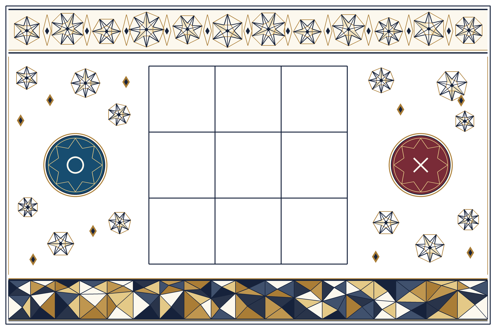

# 飛び出せ！DXまるばつげーむ！

人間2人が紙の3×3盤面に○と×を書いて対戦する、Unity・Vuforia製のARゲームです。カメラが記号を読み取ると、選んだキャラクターが紙の上に登場します。

## 現在の盤面

盤面はA4横向きで印刷します。画像ターゲットの外寸は **270 × 180 mm**。印刷倍率は100%に設定し、SVG下部の100 mm基準線を定規で確認してください。

上の完成イメージは開発初期の参考画像で、現在の画面やキャラクターモデルそのものではありません。

## 実装済みの機能

- 対局前に○側・×側のキャラクターを選択。**やがぽん、みたぬき、矢口君**から選べ、同じキャラクターは両側に選べません。
- ○を先手として、2人が紙に交互に記入。盤面認識、9マスの手書き記号の安定判定、手番・勝敗判定を連携しています。
- 縦・横・斜めに同じ記号が3つ並ぶと勝利、9マスが埋まると引き分けです。対局中の手番と終了結果は画面下部に表示します。
- 次の手番のキャラクターを盤面左右の台座に表示し、回転させます。
- 受理したマスにはキャラクターが現れます。従来より**2.5倍に拡大**し、色付きのマーカーで○・×を区別。キャラクターごとに浮遊・歩行などの動きを付けています。
- 中央マスでは手を振り、勝利時にはキャラクターのリアクション、勝利ライン、光の粒子を表示します。
- 筆跡認識は追加購入が必要なOpenCV製品を使わず、Vuforiaから受け取るカメラ画像とC#の画像処理で行います。

## 開発環境

- Unity **6000.3.24f1** / Built-in Render Pipeline
- Vuforia Engine **11.4.4**
- Windows 11 / Unity Editor の Webcam Play Mode
- OpenCV for Unityなどの有償画像処理アセットは未導入

Unity・Vuforiaのバージョンはプロジェクトに合わせてください。Vuforia Engineの配布パッケージはこの公開リポジトリには含めていません。各自で公式配布パッケージ `com.ptc.vuforia.engine-11.4.4.tgz` を取得して `Packages/` に置き、必要に応じてPackage Managerから読み込んでください。Vuforiaのライセンスキーも各PCで設定し、コードやGitには保存しないでください。

## Unity Editorで対局する

1. Unity Hubでこのフォルダーを追加し、Unity 6000.3.24f1で開きます。
2. Vuforia Engine 11.4.4を利用できる状態にし、`Assets/Marubatsu/Scenes/Phase1_BoardTracking.unity` を開きます。シーンが見つからない場合は `Marubatsu > Create Phase 1 Scene` を実行します。
3. `Window > Vuforia Configuration` で自分のライセンスキーを設定し、Play ModeをWebcamにして使用するカメラを選択します。
4. `Print/Board_A4.svg` をA4横・100%で印刷します。用紙全体と外周模様がカメラに映るように置きます。
5. Playを押し、画面のキャラクターセレクトで○側・×側のキャラクターを選んで対局を開始します。
6. 「空の盤面を映してください」と表示されたら、空の紙を映します。準備ができたら○から空きマスに1つずつ記入し、手を離して認識が安定するまで盤面を静止させます。その後、×、○の順で交互に続けます。
7. 対局終了後は「次の対戦」を選び、空の紙で次のゲームを始めます。

開発用キー:

- **F1**: 認識診断表示の切り替え。選択中マス（初期値は中央）の切り出しと二値画像を確認できます。
- **R**: 現在の対局をリセットします。紙の記号も消すか、新しい空の紙を用意してください。

### ターゲット方式

Unityシーンは `BoardTarget.png` から実行時に作る **Instant Image Target** を使用します。Vuforia Target Managerには同じ盤面画像を登録し、星4の評価を得たとの報告がありますが、そのデータベースはこのシーンに取り込んでいません。ターゲット方式を切り替える場合は別途Unity側の設定が必要です。

## 認識と検証について

基本的な実機確認は以前の構成で行われ、中央マスの切り出しは盤面と合うこと、真上からの手書き判定はおおむね動くことが確認されています。筆跡・角度・照明によって `Unknown` になる場合があり、認識精度を保証するものではありません。**直近で拡大したキャラクターの盤面表示は、最新コードで実機再確認が必要です。**

`Tools/Test-Recognition.ps1` は合成画像による筆跡分類、安定化、ゲーム入力のチェックに使えます。これは実カメラや印刷した紙での試験の代わりにはなりません。認識方式・既知の制限・検証手順は以下を参照してください。

- [プロジェクト仕様](PROJECT_SPEC.md)
- [技術調査・実装計画](Docs/TECHNICAL_PLAN.md)
- [認識の試し方と制限](Docs/PHASE2_RECOGNITION.md)
- [実機確認チェックリスト](Docs/PHASE1_CHECKLIST.md)
- [ゲームロジックの受け渡し仕様](Docs/GAME_LOGIC_HANDOFF.md)
- [キャラクターとアニメーション](Docs/CHARACTER_ANIMATION.md)

## 主なフォルダー

- `Assets/Marubatsu/Runtime/`: Vuforia追跡、カメラフレーム、盤面切り出し、筆跡認識、紙面からの着手入力
- `Assets/Marubatsu/GameLogic/`: 手番、盤面、勝敗の管理
- `Assets/Marubatsu/Presentation/`: キャラクター選択UI、盤面上のキャラクター、対戦演出
- `Assets/Marubatsu/Art/`: 盤面画像、キャラクターモデル、選択用画像、アニメーション
- `Assets/Marubatsu/Resources/MarubatsuMatchCharacters.asset`: 選択可能なキャラクターと肖像画像の一覧
- `Print/Board_A4.svg`: 印刷用盤面
- `Tools/`: 盤面生成・認識テスト用スクリプト

盤面画像と印刷用SVGの両方を更新するときは、Pillowを利用できる環境で `python Tools/generate_board.py` を実行します。
